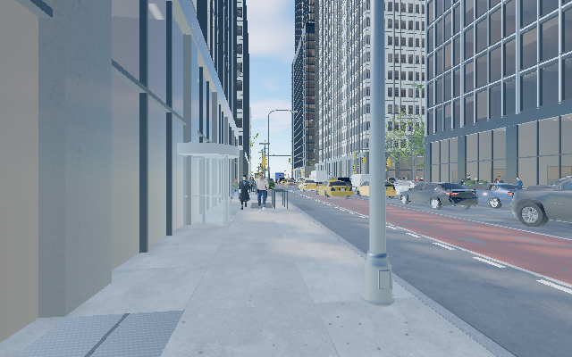
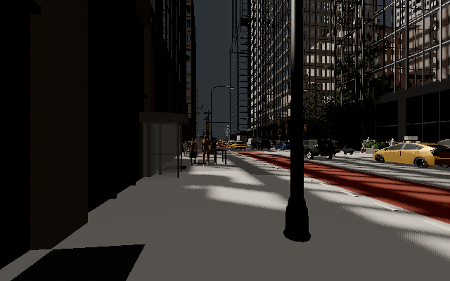

# "Why can't we just use three's WebGPURenderer?" Measured (Nov 2026)

The question: three.js ships a `WebGPURenderer` that reaches Metal through Dawn. Is our own Metal renderer really
going to be much faster, or is it a lot of work for a small win?

This note answers with a benchmark: the same scenes, the same Electron 45 app (Chromium 156), three renderers.

| | Renderer | Path to Metal |
|---|---|---|
| A | stock three r187 `WebGLRenderer` (the game as shipped) | WebGL2 -> ANGLE -> Metal, in Chromium's GPU process |
| B | stock three r187 `WebGPURenderer` (`three/webgpu`) | WebGPU -> Dawn (Tint: WGSL -> MSL) -> Metal, in Chromium's GPU process |
| C | fastrender: `FastRenderer({ programs: 'three' })` + the Electron addon | three's own GLSL -> MSL (glslang + SPIRV-Cross), our Metal renderer on a render thread of the main process |

How it is measured, and the one command that runs it on a real Mac: docs/HOST.md, "3-way benchmark"
(`host/electron/scripts/bench-3way.sh`).

## Short answer

1. **For this game, WebGPURenderer is not a drop-in, it is a port.** 391 of the street scene's 469 materials carry
   GLSL (385 `onBeforeCompile` patches, 6 `ShaderMaterial`s); they are on 2,767 of its 2,864 visible objects (97 %).
   WebGPURenderer never runs GLSL: the game boots and draws its geometry, but with the wrong look everywhere (mean
   error against the WebGL image: **107 / 255**, 99 % of pixels off; pictures below). The fix is rewriting ~1,700
   lines of GLSL in 80 shader strings as TSL, plus the cascaded-shadow rig and the post-processing chain. fastrender
   runs the same GLSL unchanged (error against WebGL on the same frame: **0.09** for the city, ~3 for the game).
2. **For a scene made of stock three materials, WebGPURenderer works as is and is the better browser renderer.** The
   city: same picture (error 2.2), ~40 % less main-thread time per frame than WebGLRenderer (2.9 vs 5.0 ms) and 1.8x
   the frame rate on the CI runner (first harness version, no back-pressure: see Results). If the game were plain materials, "switch the import to `three/webgpu`" would
   be a cheap, real win. That part of the question deserves a yes.
3. **Our renderer's measured advantage so far is CPU, and it is large.** Per frame of the city, all processes: A
   11.8 ms, B 9.8 ms of CPU; fastrender's JS is 0.6 ms and its render thread 0.6 ms (5x less main-thread time than B,
   8x less than A, before counting Chromium's GPU process, which A and B keep busy at 110-140 % of a core and
   fastrender does not use for 3D at all). For the real game: 15.7 ms of JS per frame against WebGLRenderer's 242 ms
   on the runner (where WebGL's `render()` blocks on the GPU process).
4. **The GPU side is not measured yet.** CI's GPU is paravirtual; its GPU milliseconds mostly count hypervisor
   command traffic, not shading. Whether Metal-only features (MetalFX, tile memory, GPU-driven draws) buy the Air
   fps that WebGPU cannot is exactly what `bench-3way.sh` measures on the user's M2 Air. Until that run exists, "much
   faster on the GPU" is a hypothesis, and WebGPU is closer to Metal than this project assumed (it has memoryless
   attachments and store-action control now; see below).

Recommendation at the end.

## What was measured

Scenes: the empty frame (one `render()` of an empty scene), three-city (`js/examples/city-scene.mjs`: 494 building
meshes, 18,395 instanced windows, a 2048 shadow map, 6 point lights, ~500 draws), and the real game
(cktang88/3d-world-objects at `patches/`' base + patches: three r187, `quality=low`, the 5 Av spawn view: ~25,400
objects, ~2,400 visible, ~3,100 draw calls with the cascaded shadow passes, 10.6 M triangles).

Rules (details in docs/HOST.md):

- The same scene code in all three bundles; only the module `three` resolves to differs
  (`host/electron/game/bench/three.{webgl,webgpu,fastrender}.mjs`).
- Colour buffer = the stated size in device pixels for every variant; nobody up- or downscales. MSAA off everywhere,
  because fastrender has none (the game asks for MSAA 4x: measured separately as `aa` rows for A and B).
- Every frame advances the scene by 1/60 s (the game under the goldens' deterministic driver, its dynamic resolution
  off), so frame N is the same work in every variant.
- vsync off: Chromium `--disable-gpu-vsync --disable-frame-rate-limit`, fastrender `displaySyncEnabled = false`. A
  second pass with vsync on gives CPU % at the display's rate.
- **Back-pressure for everyone:** at most two frames whose GPU work has not finished (A: a GL fence per frame, B:
  `queue.onSubmittedWorkDone()`, C: the render thread's frame counter), and the measured window ends when the GPU has
  drained. Without it the numbers lie: see "Two measurement traps".
- Per frame: frame time (p50 / p95 / p99), JS split into game update and `renderer.render`, GPU time where the
  platform gives one, draw calls. Per process (`app.getAppMetrics`): CPU and memory of the main process (C's render
  thread lives there), Chromium's GPU process (A and B translate and submit there), the page.
- A run whose GPU side is lost (WebGL context lost, WebGPU device lost) is a failure, not a frame rate.

<!-- BENCH:BEGIN -->
## Results: macOS CI runner (run 43718101131, job `bench-3way`)

**The runner's GPU is paravirtual ("Apple Paravirtual device"). Its fps and GPU ms are NOT an M2 Air's**: GPU time
there is dominated by hypervisor command traffic, the real game needs 80-200 ms of it per frame, and at 2560x1600
WebGL and WebGPU lost their GPU context on it. The CPU-side columns (JS ms, CPU % per process, CPU ms/frame) are the
informative part. 3 s warmup + 8 s measured per run.

**This is the first version of the harness** (commit 34344b0), the only one whose CI job had finished when this was
written (the macOS queue was hours deep). Two things in it were fixed afterwards and are NOT yet re-measured on a Mac:

- no back-pressure: A's and B's fps are rAF rates. For the city the GL timer query confirms A's frames were drawn
  (GPU 6.4 ms/frame); B's empty-frame "553 fps" is not trustworthy (trap 1 below);
- **every fastrender row is capped at ~10 fps by Chromium's rAF, not by the renderer** (trap 2 below): read C's JS ms,
  render-thread ms and GPU ms per frame, not its fps or its CPU % (which is per second at 10 frames a second).

Rerun: push a commit whose message contains `bench-3way` (or run the workflow manually), or run the script on a Mac.

| Per frame, CI runner | A WebGLRenderer | B WebGPURenderer | C fastrender |
|---|---:|---:|---:|
| city 1280x800: JS (main thread) ms, p50 | 5.0 | 2.9 | **0.6** |
| city: CPU ms in Chromium's GPU process | 9.1 | 6.1 | 0.1 |
| city: C's render thread ms | | | 0.6 |
| city: all processes, CPU ms | 11.8 | 9.8 | (4.5 at 10 fps: idle overhead included) |
| city: fps (uncapped) | 121 | 223 | rAF-capped |
| city: picture vs A (MAE, 0-255) | | 2.24 | 0.09 |
| empty frame: CPU ms in the GPU process | 5.3 | 2.0 | 0.2 |
| game 1280x800: JS ms p50 = update + render | 242 = 5.9 + 236 (blocked on the GPU process) | GPU lost | **15.7 = 3.0 + 11.9** |
| game: GPU ms (paravirtual) | 191 | GPU lost | 79 |
| game: all processes, CPU ms | 185 | GPU lost | 39 |
| game: memory footprint, all processes | 3.5 GB | | 3.1 GB |
| game 2560x1600 | context lost | context lost | 4.7 fps, GPU 211 ms |
| game, MSAA 4x as shipped (A only) | 3.8 fps, GPU 213 ms | | |

Where the time goes: for A and B the largest CPU cost is not three's JavaScript but Chromium's GPU process (command
decoding, ANGLE / Dawn validation and translation, the compositor): 5-9 ms per city frame, 2-5 ms even for an empty
frame. B halves three's main-thread cost against A and trims the GPU process. C's JS only writes a command stream
into shared memory (0.6 ms) and its render thread encodes Metal directly (0.6 ms); Chromium's GPU process is idle.
For the game, C's 15.7 ms of JS is three's scene-graph walk and uniform code plus FastRenderer (docs/notes), the same
work WebGLRenderer does before it blocks.

Full tables (as written by `scripts/bench-3way.report.mjs`):

### Empty frame (one render() of an empty scene), 1280x800 px, vsync off (uncapped)

| variant | fps | frame ms p50 / p95 / p99 | JS ms p50: total = update + render | GPU ms mean | draws | CPU %: main / GPU proc / page = total | CPU ms/frame | mem MB: main / GPU proc / page | vs A (MAE) |
|---|---:|---:|---:|---:|---:|---:|---:|---:|---:|
| A three WebGLRenderer (ANGLE -> Metal) | 205.3 | 1.30 / 11.80 / 30.20 | 0.20 = 0.00 + 0.10 | 1.08 | 0 | 0 / 109 / 14 = 123 | 5.98 | 166 (48) / 93 (75) / 140 (45) |  |
| B three WebGPURenderer (Dawn -> Metal) | 553.4 | 0.60 / 6.70 / 18.80 | 0.20 = 0.00 + 0.20 | n/a | 1 | 1 / 109 / 42 = 152 | 2.75 | 137 (52) / 92 (1682) / 125 (65) | 0.00 |
| C fastrender (Metal, addon) | 10.7 | 86.20 / 140.60 / 147.90 | 0.20 = 0.10 + 0.10 | 1.79 | 0 (native 0) | 2 / 0 / 1 = 3 | 3.10 | 165 (58) / 63 (11) / 211 (88) | 0.00 |

- webgl: backend: WebGL2, ANGLE Metal, Apple Paravirtual device; GPU ms: EXT_disjoint_timer_query_webgl2 (TIME_ELAPSED around the frame)
- webgpu: backend: WebGPU, apple 0x0000 Apple Paravirtual device; GPU ms: none (timestamp-query not available) (no samples)
- fastrender: backend: Metal (fastrender), fastrender render thread, main process; GPU ms: Metal command buffer GPUEndTime - GPUStartTime (mean); render thread: 10.653 fps rendered, 0 skipped, 0.24 ms/frame on the render thread (wall: encode + waiting for the drawable); 0 native draws

### Empty frame (one render() of an empty scene), 2560x1600 px, vsync off (uncapped)

| variant | fps | frame ms p50 / p95 / p99 | JS ms p50: total = update + render | GPU ms mean | draws | CPU %: main / GPU proc / page = total | CPU ms/frame | mem MB: main / GPU proc / page | vs A (MAE) |
|---|---:|---:|---:|---:|---:|---:|---:|---:|---:|
| A three WebGLRenderer (ANGLE -> Metal) | 149.5 | 1.60 / 18.70 / 29.80 | 0.20 = 0.00 + 0.10 | 3.10 | 0 | 0 / 109 / 11 = 120 | 8.02 | 177 (60) / 97 (242) / 143 (50) |  |
| B three WebGPURenderer (Dawn -> Metal) | 574.9 | 0.90 / 5.80 / 15.90 | 0.30 = 0.00 + 0.20 | n/a | 1 | 1 / 138 / 63 = 202 | 3.51 | 181 (63) / 115 (1942) / 145 (47) | 0.00 |
| C fastrender (Metal, addon) | 11.2 | 77.90 / 135.00 / 149.20 | 0.20 = 0.10 + 0.10 | 1.77 | 0 (native 0) | 2 / 0 / 1 = 3 | 2.50 | 165 (93) / 63 (11) / 212 (88) | 0.00 |

- webgl: backend: WebGL2, ANGLE Metal, Apple Paravirtual device; GPU ms: EXT_disjoint_timer_query_webgl2 (TIME_ELAPSED around the frame)
- webgpu: backend: WebGPU, apple 0x0000 Apple Paravirtual device; GPU ms: none (timestamp-query not available) (no samples)
- fastrender: backend: Metal (fastrender), fastrender render thread, main process; GPU ms: Metal command buffer GPUEndTime - GPUStartTime (mean); render thread: 11.181 fps rendered, 0 skipped, 0.21 ms/frame on the render thread (wall: encode + waiting for the drawable); 0 native draws

### three-city (js/examples/city-scene.mjs), 1280x800 px, vsync off (uncapped)

| variant | fps | frame ms p50 / p95 / p99 | JS ms p50: total = update + render | GPU ms mean | draws | CPU %: main / GPU proc / page = total | CPU ms/frame | mem MB: main / GPU proc / page | vs A (MAE) |
|---|---:|---:|---:|---:|---:|---:|---:|---:|---:|
| A three WebGLRenderer (ANGLE -> Metal) | 121.0 | 5.80 / 21.40 / 37.20 | 5.00 = 0.10 + 4.90 | 6.43 | 456 | 1 / 110 / 32 = 143 | 11.80 | 166 (48) / 92 (106) / 148 (58) |  |
| B three WebGPURenderer (Dawn -> Metal) | 223.4 | 3.80 / 10.00 / 18.30 | 2.90 = 0.00 + 2.80 | n/a | 357 | 1 / 137 / 80 = 218 | 9.75 | 170 (52) / 137 (183) / 195 (93) | 2.24 |
| C fastrender (Metal, addon) | 9.5 | 103.40 / 149.40 / 149.60 | 0.60 = 0.10 + 0.50 | 4.24 | 498 (native 282) | 2 / 0 / 3 = 4 | 4.51 | 173 (90) / 61 (11) / 260 (132) | 0.09 |

- webgl: backend: WebGL2, ANGLE Metal, Apple Paravirtual device; GPU ms: EXT_disjoint_timer_query_webgl2 (TIME_ELAPSED around the frame)
- webgpu: backend: WebGPU, apple 0x0000 Apple Paravirtual device; GPU ms: none (timestamp-query not available) (no samples)
- fastrender: backend: Metal (fastrender), fastrender render thread, main process; GPU ms: Metal command buffer GPUEndTime - GPUStartTime (mean); render thread: 9.544 fps rendered, 0 skipped, 0.60 ms/frame on the render thread (wall: encode + waiting for the drawable); 282 native draws

### three-city (js/examples/city-scene.mjs), 2560x1600 px, vsync off (uncapped)

| variant | fps | frame ms p50 / p95 / p99 | JS ms p50: total = update + render | GPU ms mean | draws | CPU %: main / GPU proc / page = total | CPU ms/frame | mem MB: main / GPU proc / page | vs A (MAE) |
|---|---:|---:|---:|---:|---:|---:|---:|---:|---:|
| A three WebGLRenderer (ANGLE -> Metal) | 128.7 | 6.50 / 17.10 / 24.60 | 6.10 = 0.00 + 6.00 | 6.14 | 451 | 1 / 110 / 29 = 140 | 10.86 | 177 (59) / 105 (263) / 157 (64) |  |
| B three WebGPURenderer (Dawn -> Metal) | 248.8 | 3.40 / 8.60 / 22.30 | 2.90 = 0.00 + 2.90 | n/a | 368 | 1 / 127 / 65 = 192 | 7.72 | 181 (63) / 144 (369) / 198 (100) | 2.24 |
| C fastrender (Metal, addon) | 11.1 | 83.40 / 138.90 / 154.10 | 0.60 = 0.10 + 0.40 | 7.35 | 498 (native 280) | 2 / 0 / 2 = 4 | 3.89 | 178 (137) / 64 (11) / 262 (142) | 0.09 |

- webgl: backend: WebGL2, ANGLE Metal, Apple Paravirtual device; GPU ms: EXT_disjoint_timer_query_webgl2 (TIME_ELAPSED around the frame)
- webgpu: backend: WebGPU, apple 0x0000 Apple Paravirtual device; GPU ms: none (timestamp-query not available) (no samples)
- fastrender: backend: Metal (fastrender), fastrender render thread, main process; GPU ms: Metal command buffer GPUEndTime - GPUStartTime (mean); render thread: 11.052 fps rendered, 0 skipped, 0.64 ms/frame on the render thread (wall: encode + waiting for the drawable); 280 native draws

### 3d-world-objects, 5 Av street view, quality=low, 1280x800 px, vsync off (uncapped)

| variant | fps | frame ms p50 / p95 / p99 | JS ms p50: total = update + render | GPU ms mean | draws | CPU %: main / GPU proc / page = total | CPU ms/frame | mem MB: main / GPU proc / page | vs A (MAE) |
|---|---:|---:|---:|---:|---:|---:|---:|---:|---:|
| A three WebGLRenderer (ANGLE -> Metal) | 4.2 | 244.30 / 323.10 / 347.30 | 242.00 = 5.90 + 235.90 | 191.43 | 3080 | 1 / 46 / 31 = 77 | 184.55 | 116 (47) / 410 (2078) / 692 (1345) |  |
| A three WebGLRenderer (ANGLE -> Metal), aa (MSAA 4x) | 3.8 | 255.70 / 323.00 / 401.80 | 253.50 = 4.90 + 249.40 | 212.71 | 3080 | 1 / 41 / 28 = 70 | 180.83 | 158 (51) / 529 (2128) / 1026 (1455) | 2.39 |
| B three WebGPURenderer (Dawn -> Metal) | **failed** | GPU lost during the run: Metal command buffer failed: Caused GPU Timeout Error (00000002:kIOGPUCommandBufferCallbackErrorTimeout) (domain=MTLCommandBufferErrorD | | | | | | | |
| B three WebGPURenderer (Dawn -> Metal), aa (MSAA 4x) | **failed** | timeout 611 s | | | | | | | |
| C fastrender (Metal, addon) | 8.2 | 119.80 / 161.20 / 178.50 | 15.70 = 3.00 + 11.90 | 79.20 | 2847 (native 1504) | 13 / 0 / 19 = 32 | 38.64 | 967 (1170) / 102 (265) / 1152 (1685) | 3.58 |

- webgl: backend: WebGL2, ANGLE Metal, Apple Paravirtual device; GPU ms: EXT_disjoint_timer_query_webgl2 (TIME_ELAPSED around the frame); boot 28.3 s
- webgl aa: backend: WebGL2, ANGLE Metal, Apple Paravirtual device; GPU ms: EXT_disjoint_timer_query_webgl2 (TIME_ELAPSED around the frame); boot 9.6 s
- fastrender: backend: Metal (fastrender), fastrender render thread, main process; GPU ms: Metal command buffer GPUEndTime - GPUStartTime (mean); render thread: 8.23 fps rendered, 0 skipped, 12.17 ms/frame on the render thread (wall: encode + waiting for the drawable); 1504 native draws; boot 14.2 s

### 3d-world-objects, 5 Av street view, quality=low, 2560x1600 px, vsync off (uncapped)

| variant | fps | frame ms p50 / p95 / p99 | JS ms p50: total = update + render | GPU ms mean | draws | CPU %: main / GPU proc / page = total | CPU ms/frame | mem MB: main / GPU proc / page | vs A (MAE) |
|---|---:|---:|---:|---:|---:|---:|---:|---:|---:|
| A three WebGLRenderer (ANGLE -> Metal) | **failed** | timeout 611 s | | | | | | | |
| A three WebGLRenderer (ANGLE -> Metal), aa (MSAA 4x) | **failed** | timeout 611 s | | | | | | | |
| B three WebGPURenderer (Dawn -> Metal) | **failed** | timeout 611 s | | | | | | | |
| C fastrender (Metal, addon) | 4.7 | 206.40 / 307.90 / 336.10 | 23.00 = 5.10 + 17.70 | 210.80 | 2856 (native 1502) | 16 / 0 / 19 = 35 | 74.34 | 1140 (1213) / 162 (321) / 1728 (1656) |  |

- fastrender: backend: Metal (fastrender), fastrender render thread, main process; GPU ms: Metal command buffer GPUEndTime - GPUStartTime (mean); render thread: 4.859 fps rendered, 0 skipped, 119.38 ms/frame on the render thread (wall: encode + waiting for the drawable); 1502 native draws; boot 5.4 s
<!-- BENCH:END -->

## The real game under WebGPURenderer: what renders, what breaks

Variant B for the game is literally "use WebGPURenderer and change nothing else": the game's `new
THREE.WebGLRenderer()` receives an initialised `WebGPURenderer`, WebGL-only imports (`ShaderChunk`, `ShaderLib`,
`UniformsLib`) still resolve so the game's shader-patching code loads, and nothing is ported. (The one concession: the
renderer is created and `await init()`-ed before the game's module runs, because WebGPU initialisation is
asynchronous and the game renders synchronously at load.)

It boots. The level builds, 163 assets load, the frame loop runs, there are no WebGPU validation errors. The same
view, WebGLRenderer (left) and WebGPURenderer (right), software GPU, 640x400, HUD hidden:

| WebGLRenderer (the game as shipped) | WebGPURenderer, nothing ported |
|---|---|
|  |  |

Mean absolute error between the two: **106.9 / 255, 98.7 % of pixels off by more than 24** (the city scene, stock
materials only: 2.9, 4.6 %). What the picture shows, and why:

| What is wrong | Cause |
|---|---|
| Black sky | The sky dome is a `ShaderMaterial` (`SkyShader`). WebGPURenderer: `NodeBuilder: Material "ShaderMaterial" is not compatible`, replaced by an empty `NodeMaterial`. Same for the 5 other `ShaderMaterial`s (13 visible objects in all: weather, street trees, the window-view capture, the environment blend). |
| No ambient / reflected light: every surface away from the sun is black | The game builds its environment (PMREM blend of a room environment and the sky) with a `ShaderMaterial` pass and applies sky/ambient terms in `onBeforeCompile` patches. Neither runs. |
| Hard, wrong shadows over everything | The cascaded shadow rig is three's WebGL `CSM` addon: it works by patching every material's GLSL (`onBeforeCompile`, `ShaderChunk`) and the game hooks `renderer.shadowMap.render` for per-cascade layers. Under WebGPU the cascade lights are just overlapping directional shadow lights with no cascade selection and no fade. (The WebGPU equivalent is a different addon, `CSMShadowNode`.) |
| Glass towers are black, no lit windows / interiors | The window material (`roomMaterial`: interior parallax, lamp glow, per-instance attributes) is `MeshStandardMaterial` + `onBeforeCompile`. WebGPURenderer converts the material to `MeshStandardNodeMaterial` and never calls the patch: the plain base material is drawn. |
| Pavement, facades, cars, people lose their look (triplanar PBR, weather wetness, vertex-animated crowd) | Same: 385 materials are a built-in material + an `onBeforeCompile` GLSL patch. All of them render as the unpatched built-in material. The crowd's vertex-animation-texture patch not running means the people do not animate. |
| No haze, wrong tone | Fog and grading terms live in the same patches. |

Counts from the run (`census` in the run's JSON; identical in the WebGL and WebGPU runs, it is the same scene):

| Materials in the street scene | Materials | Visible objects using them | Under WebGPURenderer |
|---|---:|---:|---|
| plain three materials, no GLSL | 78 | 97 | converted to node materials automatically: correct |
| built-in material + `onBeforeCompile` | 385 | 2,754 | drawn, but as the unpatched base material: the patch is never called (no error, no warning) |
| `ShaderMaterial` | 6 | 13 | error, drawn with an empty material |
| total | 469 | 2,864 | 3 % of visible objects render as authored |

Draw calls per frame: WebGL 3,108 (10.6 M triangles), WebGPU 1,645 (5.7 M): WebGPURenderer does less work than the
game asks for (fewer shadow passes, and the cheap base shaders instead of the game's). So **any frame rate measured
for B on the game is the frame rate of a different, cheaper, wrong picture**; it is a lower bound on cost for a real
port, not a like-for-like number, and the tables mark it so.

On the CI runner the game under WebGPURenderer did not survive at all in the first runs: the paravirtual GPU needs
~190 ms per frame for this scene, the page kept submitting frames, and Metal killed a command buffer
(`kIOGPUCommandBufferCallbackErrorTimeout`), which Dawn turns into a lost device. That is an artefact of that GPU
(and of submitting without back-pressure), not a WebGPU property; it is why back-pressure and loss detection are in
the harness.

## The TSL porting cost for a GLSL-based game

What "port to WebGPURenderer" means for 3d-world-objects, counted in its source (`src/`, at the patched commit):

| Item | Count | TSL / WebGPU equivalent |
|---|---:|---|
| GLSL in template strings | **1,677 lines in 80 strings, 16 files** (largest: `weather.ts`, `nyc/ground.ts`, `nyc/people.ts`, `lighting.ts`, `materials.ts`, `nyc/buildings-win.ts`) | every line rewritten as TSL node graphs (`Fn`, `positionLocal`, `texture()`, `mix`...): there is no GLSL-to-TSL translator, and `onBeforeCompile` string surgery has no counterpart (TSL replaces whole material slots: `colorNode`, `positionNode`, `normalNode`...) |
| `onBeforeCompile` patch sites | 41 in 17 files | per site: decide which node slots the patch maps to; patches that splice into the middle of three's lighting chunks need three's node lighting model extended instead |
| `ShaderMaterial` | 7 | `NodeMaterial` with `fragmentNode` / `vertexNode` |
| `ShaderChunk` edits, custom depth / distance materials, `customProgramCacheKey` | 43 references | `castShadowNode`, `castShadowPositionNode`, `receivedShadowNode`; chunk edits have no equivalent |
| Cascaded shadows: three's `CSM` addon + the game's `shadowMap.render` hook (per-cascade layers, far cascade every 4th frame) | 1 rig | `CSMShadowNode` (different API, no per-cascade hook: the update-rate trick must be rebuilt) |
| Post-processing: `EffectComposer`, `GTAOPass`, `UnrealBloomPass`, `OutputPass`, a custom grade `ShaderPass` (the `high` / `ultra` tiers) | 21 references | `PostProcessing` / `RenderPipeline` with TSL `pass()`, `ao()`, `bloom()` nodes; the grade pass rewritten |
| PMREM environment blend on cube targets (a `ShaderMaterial` pass) | 1 | rewritten on the WebGPU `PMREMGenerator` / `CubeRenderTarget` |
| Renderer start-up | synchronous today | `await renderer.init()` before the first render: the boot sequence changes |

Estimate: **3 to 5 engineer-weeks** for someone fluent in both, most of it not typing but re-validating 469
materials against the current look (this project's golden-image tooling would help), with the highest risk in the
patches that modify three's lighting internals (weather wetness, the window interiors) and in the crowd's vertex
animation. This is an estimate from the counts above, not a measurement. Two things it buys that fastrender does not:
one codebase for WebGPU and WebGL2 (WebGPURenderer falls back to a WebGL2 backend running the same TSL), and it runs
in a plain browser tab on every platform.

What the port would not change: the game would still pay Chromium's GPU process per frame, and its GPU cost would be
whatever WebGPU can express (next section).

## What WebGPU can and cannot express on Apple GPUs

Checked against three r187's WebGPU backend source and the adapter Chromium 156 exposed in the runs
(`backend.features` in each run's JSON). This corrects two assumptions in docs/FPS_ESTIMATES.md ("wgpu hides tile
memory", "the same lack of TBDR features").

**WebGPU can, today:**

| Metal feature | WebGPU | three r187 uses it |
|---|---|---|
| Load / store actions per attachment (do not load, do not store: the TBDR basics) | `loadOp: 'clear' / 'load'`, `storeOp: 'store' / 'discard'` | yes: `storeOp: 'discard'` for depth and for multisampled colour that is resolved (`WebGPUBackend.js`) |
| MSAA resolve inside the pass (`MTLStoreActionMultisampleResolve`) | `resolveTarget` | yes |
| **Memoryless attachments** (`MTLStorageModeMemoryless`: depth / MSAA buffers that never touch DRAM) | `GPUTextureUsage.TRANSIENT_ATTACHMENT` (a recent addition to the spec) | yes, for multisampled attachments it discards, when the browser exposes it (`WebGPUTextureUtils.js`); each run records whether Chromium 156 does (`backend.transientAttachment`) |
| Half-precision shading | WGSL `f16` (`shader-f16`: present on the runner's adapter) | not by default (its materials compute in `f32`) |
| Compute, indirect draws (`indirect-first-instance`): GPU culling is possible | yes | not for scene culling |
| Asynchronous pipeline compilation (no hitch on first use) | `createRenderPipelineAsync` | yes (`compileAsync`) |
| ASTC / BC / ETC2 textures, depth clip control, dual-source blending, float filtering | features present on the adapter | yes |
| GPU timing | `timestamp-query` | yes (`trackTimestamp`); **not offered by the paravirtual adapter**, to be seen on the Air |

**WebGPU cannot (no API, on any browser):**

| Metal feature | Why it matters on an M2 Air | Workaround in WebGPU |
|---|---|---|
| Tile shading, programmable blending / framebuffer fetch, imageblocks, raster order groups | G-buffer or intermediate results stay in tile memory: single-pass deferred, in-pass tone mapping / fog / decals with no DRAM round trip | none: every "read what I just drew" is a second pass over a stored texture (bandwidth, the Air's scarce resource) |
| MetalFX (spatial, temporal, frame interpolation, denoising) | render a quarter of the pixels, let the OS upscaler finish | an FSR1 / TAAU pass written in WGSL: works, costs GPU time MetalFX spends in Apple's tuned kernels, lower quality at the same scale |
| Metal 4 (`MTL4` command allocators, argument tables, residency sets, the flexible pipeline compiler, ML passes) | lower CPU per draw, cheaper pipeline variants | none until Dawn adopts it internally, invisible to the page either way |
| Rasterization rate maps (variable-rate shading), vertex amplification, tessellation, mesh shaders | shade the periphery / distance at lower rate | none |
| Bindless (argument buffers with arrays of textures), multi-draw indirect with a count buffer | one draw call for many materials: the real fix for a 3,000-draw frame | `multi-draw-indirect` exists only as an experimental Chromium flag; bindless is a proposal. Per-draw `setBindGroup` + `draw` remains |
| Offline-compiled shaders (`metallib`, `MTLBinaryArchive` shipped with the app) | zero shader compilation on a user's first launch | none: WGSL -> Tint -> MSL -> Metal compile at run time (Chromium keeps its own on-disk cache after the first run) |
| Presentation control (`CAMetalLayer`: display sync, drawable count, present-at-time, direct-to-display) | latency, pacing | none: the canvas is composited by Chromium; frames go when its compositor says |
| Storage modes, heaps, purgeable / sparse textures | memory on an 8 GB machine | none |
| Encoding from several threads into one pass (parallel render encoders) | CPU scaling of big frames | none |

And one cost WebGPU adds that neither list covers: **every call crosses a process boundary**. The page's WebGPU (and
WebGL) calls are serialised to Chromium's GPU process, validated there, and only then become Metal calls. That is the
GPU-process CPU column in the tables: the largest single CPU cost of A and B, and absent in C.

**What fastrender uses of the "cannot" list today** (to be honest about the gap between "could" and "does"): on the
path the real game runs (`programs: 'three'`, three's own shaders translated to MSL) it is a forward renderer with
correct load / store actions, memoryless depth, native shadow passes, and optional MetalFX (spatial or temporal)
behind a render scale. It does **not** use tile shading, Metal 4, GPU-driven draws or rate maps on that path; the
tile-memory deferred path and GPU culling exist only for the native demo scenes (`src/mac.rs`). So in the like-for-like
rows C's advantage is architecture (no translation layer per call, no second process, a render thread next to the
JS thread), not Metal-only features. The MetalFX rows are the one Metal-only feature measured.

## Two measurement traps (found while building this)

1. **Chromium does not reliably hold `requestAnimationFrame` back when the GPU is the slower side.** WebGPU on a
   software adapter accepted 306 frames in one second and needed 90 s to draw them; the first CI run "measured"
   553 fps for an empty WebGPU frame while the GPU process's memory footprint grew to 1.7 GB. A frame rate taken from
   rAF deltas alone counts frames that were never drawn. The harness therefore waits for the GPU (fence /
   `onSubmittedWorkDone` / the render thread) with at most two frames in flight and drains before closing the window.
   `--pace free` shows the raw behaviour.
2. **A page with nothing to present gets a slow `requestAnimationFrame` under `--disable-frame-rate-limit`.**
   fastrender's page is transparent and draws no pixels itself; with the uncapping flags its rAF fired at ~10 Hz on
   the runner (first run: every fastrender row was 9-11 fps, including the empty frame, with 0.2 ms of JS and a
   0.2 ms render thread). Uncapped fastrender runs now schedule frames from the task queue, not rAF. With vsync on
   (no uncapping flags) the existing host measured rAF at the display's rate; the vsync pass re-checks it. Worth
   remembering for the product: the game's frame rate in this host is Chromium's rAF rate for a page with no damage.

## Recommendation

1. **Do not switch this game to WebGPURenderer now.** It is a 3-5 week port of 1,700 lines of GLSL with a real risk
   of visual regressions, to arrive at a renderer whose CPU cost per frame (measured) is several times fastrender's
   and whose GPU ceiling on Apple silicon (not yet measured) is at best equal. fastrender already runs the game's
   shaders unchanged and matches WebGL's picture.
2. **Run `host/electron/scripts/bench-3way.sh` on the M2 Air before investing further in GPU-side work.** It is the
   missing half of the answer. Read it like this:
   - like-for-like rows (same pixels, no MSAA): if C's frame time at 2560x1600 is not clearly below A's, the GPU is
     the limit and the translation layers do not matter there; the lever is then pixels (the MetalFX rows) and
     passes, not the API.
   - MetalFX rows: if C at half resolution + MetalFX is the only configuration that holds 60 fps at 2560x1600, that
     is the case for a native renderer, because it is the part WebGPU cannot do (it can only imitate it with FSR in a
     shader).
   - vsync rows: CPU % at 60 Hz is the battery and thermal cost on a fanless machine; A and B pay for Chromium's GPU
     process, C does not.
3. **Keep WebGPURenderer as the honest baseline, and as plan B.** If the Air shows the game GPU-bound with A, B and C
   within ~20 % of each other at equal settings, the simpler product is a tuned browser build (render scale + FSR,
   fewer passes), and the TSL port becomes the route to it (one codebase, every platform). The benchmark stays in CI
   (job `bench-3way`, on request) so that claim can be re-checked as three and Chromium move.
4. **If we keep building fastrender, spend the effort where WebGPU cannot follow**: the MetalFX path as the default
   tier on the Air, tile-memory post effects (fog / tone map / bloom threshold in the main pass), draw submission that
   does not scale with three's 3,000 draw calls. Matching WebGPU feature for feature in a forward renderer would make
   the CPU win the only win.

## Reproduce

```bash
host/electron/scripts/bench-3way.sh              # everything, on this Mac: ~25 min -> host/electron/bench-out/bench-3way.md
cd host/electron && npx electron game/bench-main.js --variant webgpu --scene world --px 1280x800 \
  --html ../../../3d-world-objects/index.html --assets ../../../3d-world-objects/public --out /tmp/b   # one run
```
